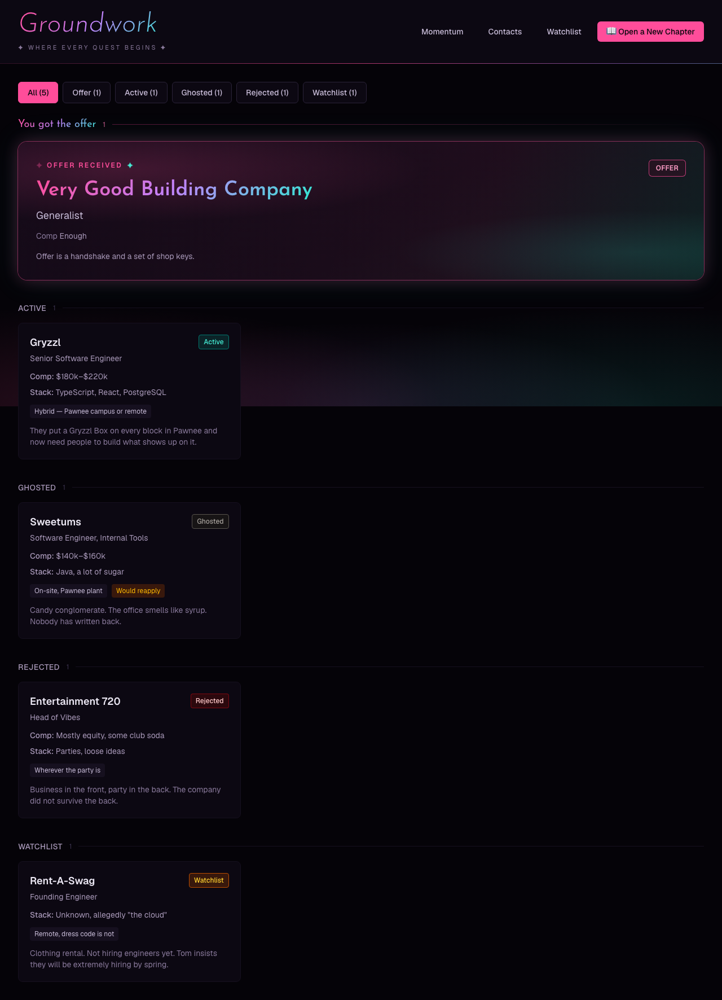
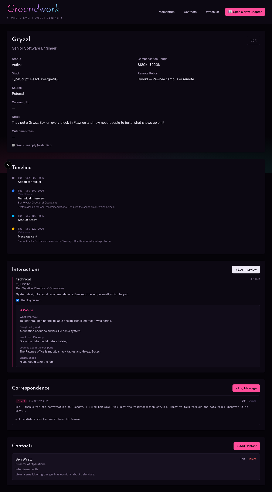
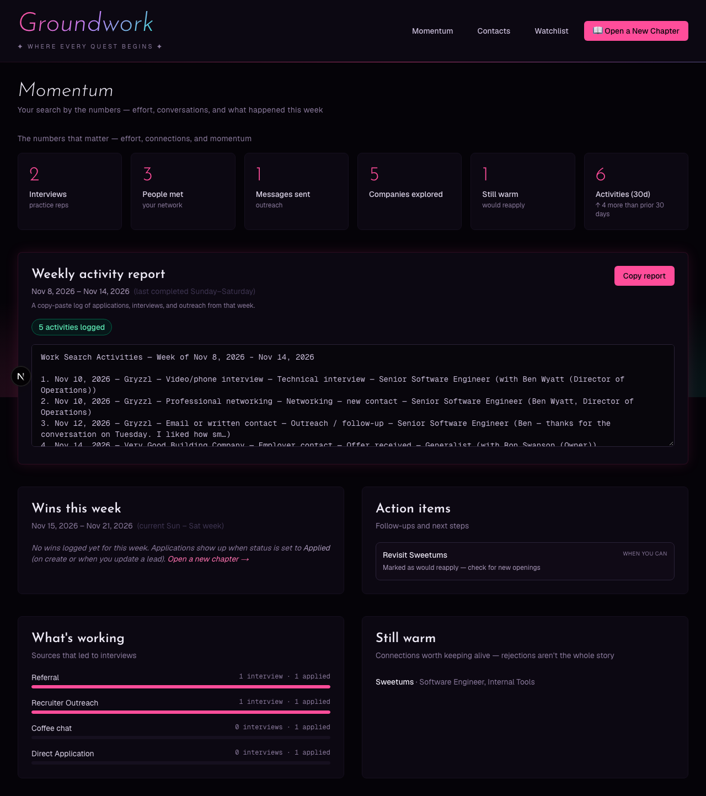

# Groundwork

A local job-search tracker. Companies, conversations, debriefs, and a weekly activity log stay in a SQLite file on your machine. There is no account and no hosted sync.



## What you can track

- **Pipeline.** Companies grouped by where they are, including an offer spotlight and a ghosted group for applied, active, or waiting roles with no activity for two months.
- **Company page.** Notes, a timeline, interviews and other interactions, a debrief, messages you paste in, and contacts.
- **Momentum.** Counts for the search, a Sunday–Saturday activity report you can copy, wins, follow-ups, and which sources led to interviews.
- **Watchlist and contacts.** Roles you want to come back to, and people you have talked to.





A short walkthrough of the sample data is in [docs/demo.webm](docs/demo.webm).

## Run it locally

You need Node.js 20 or newer.

```bash
npm install
npm run db:migrate
npm run db:seed   # optional fictional sample
npm run dev
```

Open [http://localhost:3000](http://localhost:3000).

The database file is `groundwork.db` in the project directory. To put it somewhere else, copy `.env.example` to `.env.local` and set `DATABASE_URL` to a filesystem path (not a `file:` URL). `.env.local` and `*.db` are gitignored.

`npm run db:seed` loads a small Parks and Recreation sample so you can click around before entering your own search. It refuses to run if the database already has companies. `SEED_FORCE=1 npm run db:seed` deletes those rows and loads the sample instead.

To start from an empty tracker, skip the seed and use **Open a New Chapter**.

## Tests

```bash
npm test
npx playwright install chromium
npm run test:e2e
```

`npm test` covers date and ghosting rules, the company and interaction API, and the pipeline filters. Playwright runs the app against a throwaway database and walks the sample search.

## Scripts

| Command | What it does |
| --- | --- |
| `npm run dev` | Dev server |
| `npm run db:migrate` | Apply SQLite migrations |
| `npm run db:seed` | Load the sample, unless you already have data |
| `npm run db:studio` | Open Drizzle Studio on the local database |
| `npm test` | Unit, API, and component tests |
| `npm run test:e2e` | Playwright |

## License

[MIT](LICENSE)
